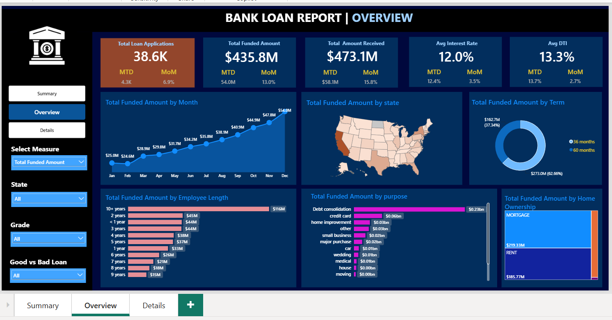
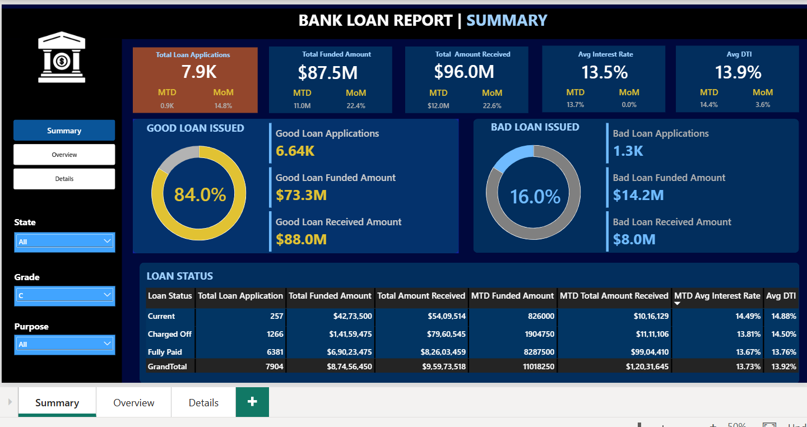
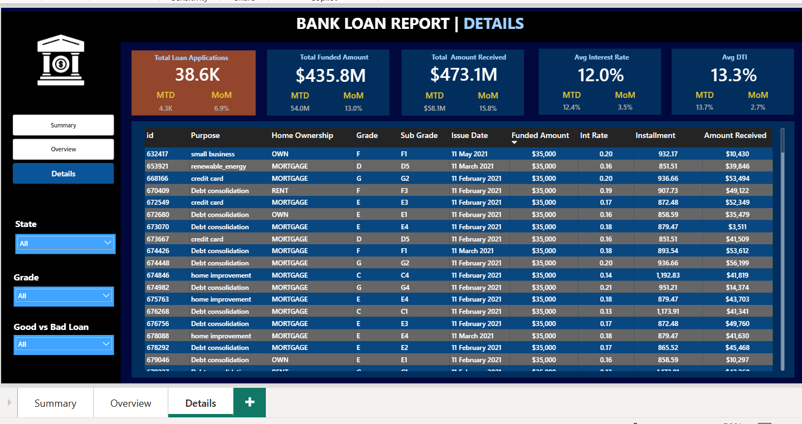

# Bank Loan Analysis Dashboard | SQL & Power BI

## Project Overview
This project focuses on analyzing bank loan data using SQL and Microsoft Power BI. It provides insights into loan applications, funded amounts, amounts received, interest rates, debt-to-income (DTI) ratios, and good versus bad loan performance.

## Project Objectives
- Analyze total loan applications and funded amounts.
- Compare amounts funded with amounts received.
- Identify good loans and bad loans.
- Analyze loan performance by state, grade, purpose, term, and employee length.
- Track monthly trends and key performance indicators.
- Build an interactive Power BI dashboard with filters and detailed loan records.

## Tools & Technologies
- SQL / MySQL
- Microsoft Power BI
- DAX
- Data Analysis and Visualization

## Dashboard Pages

### 1. Summary
Displays key performance indicators, good loan and bad loan analysis, and loan status information.

### 2. Overview
Shows funded amount trends by month, state-wise distribution, loan term, employee length, loan purpose, and home ownership.

### 3. Details
Provides detailed loan-level records, including loan purpose, home ownership, grade, sub-grade, issue date, funded amount, interest rate, installment, and amount received.

## Project Files
- **Domain Knowledge Report:** Background research and understanding of the banking loan domain.
- **Dataset / Database:** Data used for the analysis.
- **Problem Statement:** Business problem and project objectives.
- **Query Document:** Explanation of the SQL analysis.
- **SQL Queries:** SQL scripts used to analyze the data.
- **Power BI Dashboard:** Interactive dashboard file (`.pbix`).

## Key Skills Demonstrated
SQL querying, data analysis, KPI development, DAX, data visualization, dashboard design, and business insights.

## How to Use
1. Download or clone this repository.
2. Review the dataset, problem statement, and domain knowledge report.
3. Run the SQL scripts using a compatible database and the required dataset.
4. Open the `.pbix` file using Microsoft Power BI Desktop.

*Note: Database setup and data source configuration may be required before running the SQL scripts or refreshing the Power BI dashboard.*
